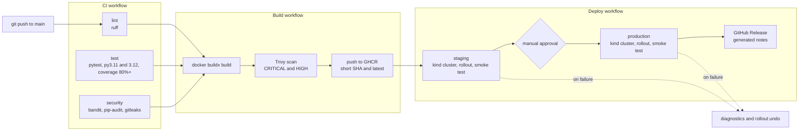

# cicd-pipeline-python

[](https://github.com/Gioomoraes/cicd-pipeline-python/actions/workflows/ci.yml)
[](https://github.com/Gioomoraes/cicd-pipeline-python/actions/workflows/build.yml)
[](https://github.com/Gioomoraes/cicd-pipeline-python/actions/workflows/deploy.yml)

An end-to-end CI/CD pipeline built with GitHub Actions: lint, tests, security scanning, a scanned Docker image published to GHCR, and a gated deploy to staging and production with smoke tests and automatic rollback.

> The Python API is intentionally tiny. The point of this project is the delivery pipeline around it, not the application.

## Pipeline overview



The three workflows are chained with `workflow_run`, so each stage only starts after the previous one succeeded, and every stage works on the exact commit that passed the earlier checks.

| Workflow | Trigger | What it does |
|---|---|---|
| **CI** | push to `main`, pull requests | `ruff` lint and format check; `pytest` on Python 3.11 and 3.12 with a coverage gate of 80%; security job with `bandit`, `pip-audit` and `gitleaks`. Outdated runs are cancelled. |
| **Build** | CI succeeded on `main` | Builds the image once, scans it with Trivy (fails on fixable CRITICAL/HIGH findings), and only then pushes it to GHCR tagged with the short commit SHA and `latest`. |
| **Deploy** | Build succeeded | Deploys the image by SHA to **staging** automatically, runs a smoke test, then waits for a **manual approval** before deploying to **production**. On failure it prints diagnostics and runs `kubectl rollout undo`. On success the production job publishes a GitHub Release with generated notes. |
| **Dependabot** | weekly | Opens update PRs for `pip` and `github-actions`. Each PR runs the full CI. |

## Tech stack

Python 3.11/3.12, FastAPI, pytest, ruff, Docker (buildx, multi-stage image), GitHub Actions, GitHub Container Registry, Trivy, bandit, pip-audit, gitleaks, Dependabot, Kubernetes manifests, kind.

## Security checks

| Layer | Tool | Where |
|---|---|---|
| Secrets in git history | gitleaks | CI |
| Static analysis of the code | bandit | CI |
| Vulnerable dependencies | pip-audit, Dependabot | CI, weekly PRs |
| Vulnerable image contents | Trivy | Build, before the push |
| Workflow permissions | least privilege per workflow and job | all workflows |
| Production changes | required reviewer on the `production` environment | Deploy |

## Design decisions

- **Build once, scan before publishing.** The image is built and loaded locally, scanned, and only pushed if the scan passes. An unscanned image never reaches the registry.
- **Immutable tags.** Deployments use the commit SHA, not `latest`, so a deployed version always maps to one commit.
- **Smoke test as a gate.** `scripts/smoke_test.py` (standard library only) polls `/health` and checks that `/version` matches the commit being deployed. A wrong version fails the deploy.
- **Least privilege.** Workflows default to read-only permissions and only the jobs that need more (package writes, release creation) ask for it.
- **No context interpolation inside `run` blocks.** Values like the commit SHA are passed through `env`, which avoids script injection through workflow context.
- **Serialised deploys.** A `deploy` concurrency group prevents two deployments from running at the same time.

## Repository layout

```
.
├── .github/workflows/     # ci.yml, build.yml, deploy.yml
├── .github/dependabot.yml
├── .kiro/steering/        # rules given to the AI agent used to scaffold files
├── app/                   # FastAPI application
├── tests/                 # pytest suite
├── k8s/                   # Deployment and Service manifests
├── scripts/               # smoke_test.py, release_notes.py
├── Dockerfile
├── docker-compose.yml
├── Makefile
└── pyproject.toml
```

## Run it locally

```bash
python -m venv .venv
source .venv/bin/activate          # Git Bash on Windows: source .venv/Scripts/activate
pip install -e ".[dev]"

ruff check .
ruff format --check .
pytest --cov=app --cov-fail-under=80

APP_VERSION=dev uvicorn app.main:app --port 8000
```

In another terminal, run the same smoke test the pipeline uses:

```bash
python scripts/smoke_test.py --url http://localhost:8000 --expected-version dev
```

With Docker installed:

```bash
docker compose up
```

## Author - Giovanna Moraes 💜
